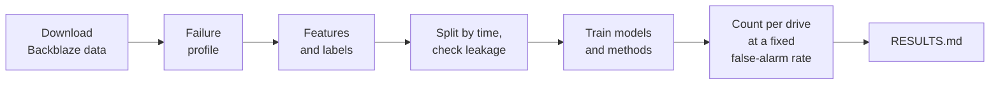

# Drive failure baseline

Predict which hard drives will fail in the coming week from their daily
SMART readings, and measure it fairly. Built on the public
[Backblaze Drive Stats dataset](https://www.backblaze.com/cloud-storage/resources/hard-drive-test-data)
(2023 Q4 – 2026 Q3, 417,169 data hard drives, 13,574 failures).

**Licence:** Apache-2.0 ([`LICENSE`](LICENSE)). **Data:** public; no
account, key or agreement needed.

The repository holds:

- **A fixed benchmark** ([`benchmark/v1/`](benchmark/v1/)): time-based
  train / validation / test splits, source checksums, the label rule and
  per-split counts, plus metric code (`dfb evaluate`) to score any method
  on exactly the same data.
- **Trained baselines**, from a simple SMART rule to gradient boosting.
- **A comparison of resampling (SMOTE) with generated synthetic failures
  (CTGAN)** on identical splits.
- **Code for every step**, with tests, and a log of every setting tried.

## Results at a glance

Test period April–September 2026: 371,793 drives, 2,681 failures. The
alarm threshold is set on the validation period for a given false-alarm
rate, then applied unchanged to test. Mean of 3 seeds; warning window 7
days.

| Model | Failures caught at 1% false alarms | Caught at 0.1% false alarms | Median days of warning |
|---|---|---|---|
| SMART rule (5 error counters) | 20.0% | 11.8% | 6 |
| Random forest | 41.7% | 12.4% | 6 |
| LightGBM | 52.1% | 15.0% | 6 |
| Logistic regression | 55.0% | **18.1%** | 6 |
| **Blend of LightGBM and logistic regression** | **57.7%** | 18.0% | 6 |

Accuracy is not used: a model that always says "healthy" is right on
99.98% of test drive-days and catches nothing.

**Resampling vs synthetic failures** (LightGBM, both methods add the same
number of failure rows):

| Method | Caught at 1% false alarms | Caught at 0.1% false alarms |
|---|---|---|
| Class weighting, no rows added | 52.1% | 15.0% |
| SMOTE, neighbours from other drives | **54.4%** | 14.8% |
| CTGAN synthetic failures | 53.7% | **16.7%** |

What this shows:

- **Learned models catch about 2.9 times as many failures as the SMART
  rule** at the same false-alarm rate, with most of the week to spare.
- **With LightGBM, both SMOTE and CTGAN beat class weighting when set up
  carefully;** CTGAN does best when false alarms must be very rare.
- **CTGAN is unstable with logistic regression.** In the first setup
  (no sampling weights), logistic regression with CTGAN caught 53.4%,
  24.5% and 50.1% on its three seeds (mean 42.7%, against 55.0% with
  class weighting): each seed's synthetic rows differ, and the linear
  model follows them. LightGBM in the same setup stayed within 49.8–51.4%.
- **Standard SMOTE makes near-copies on daily drive data:** two-thirds of
  its new rows blend a failing drive with one of its own other days.
  Taking neighbours from other drives fixes it.
- **Setup matters more than method.** The first setup trained SMOTE and
  CTGAN without the sampling weights the baseline used, and SMOTE caught
  only 43.3%. That flaw was ours, not SMOTE's; the original numbers are
  kept in `RESULTS.md` next to the corrected ones.
- **Blending two model types helps more than tuning.** Tuning LightGBM
  added under 1 point; the blend added 2.7 over the best single model.
- **Longer windows catch more:** 57% with 14 days (about 12 days of
  warning), 63% with 30 days.
- **About 19% of failing drives give no warning in their SMART error
  counters:** none of the five is above zero in their last week, and the
  models catch almost none of these drives. Catching them would need
  signals other than SMART error counts.

Every table (other windows and false-alarm budgets, results by brand,
capacity, age and drive model, every study run):
[`results/benchmark_v1/RESULTS.md`](results/benchmark_v1/RESULTS.md).

## How it works



| Step | What happens | Command | Details |
|---|---|---|---|
| 1. Data | Download 12 quarters from Backblaze, record checksums, convert each to one declared Parquet schema, check value rules | `dfb prepare`, `dfb verify` | [`EVALUATION.md`](EVALUATION.md) §2 |
| 2. Profile | Failure rates by drive model, brand, capacity, age and quarter; this set the scope (data hard drives, 3-year window) | `dfb profile` | [`reports/failure_profile.md`](reports/failure_profile.md) |
| 3. Features and labels | For each drive-day: 14 SMART attributes, the change over 7 and 30 days in six error counters, age, capacity, brand. A day is positive if the drive fails within the next N days | `dfb features` | [`docs/design/implementation.md`](docs/design/implementation.md) |
| 4. Splits | Train to Sep 2025, validate Oct 2025 – Mar 2026, test Apr – Sep 2026. Automatic checks stop any run where future data could reach training | `dfb splits` | [`EVALUATION.md`](EVALUATION.md) §3 |
| 5. Train | 5 models, from always-healthy to LightGBM, with class weighting; undersampling, SMOTE and CTGAN compared on logistic regression and LightGBM; 3 seeds | `dfb bench` | [`EVALUATION.md`](EVALUATION.md) §7 |
| 6. Evaluate | Per drive: a failing drive is caught if alarmed within its window; a healthy drive that ever alarms is a false alarm. Threshold set on validation | (part of `bench`) | [`EVALUATION.md`](EVALUATION.md) §4–5 |
| 7. Studies | SMOTE settings, then tuning and blending, chosen on validation only; every attempt logged | `dfb smote-study`, `dfb improve` | [`docs/decisions.md`](docs/decisions.md) M-4 to M-6 |
| 8. Report | All tables | `dfb report` | [`RESULTS.md`](results/benchmark_v1/RESULTS.md) |

Every parameter and the reason for it is in
[`docs/decisions.md`](docs/decisions.md). To step through the whole
project with code and charts, open
[`notebooks/01_end_to_end.ipynb`](notebooks/01_end_to_end.ipynb).

## Check it in about 10 minutes

```bash
python -m venv .venv
.venv/bin/pip install torch==2.8.0 --index-url https://download.pytorch.org/whl/cpu
.venv/bin/pip install -e ".[dev,models]"
.venv/bin/dfb quickcheck
```

This downloads one quarter (about 1 GB), converts and validates it,
checks it against the frozen benchmark's checksum and stored counts, and
runs the unit tests.

## Reproduce everything

Needs about 16 GB of memory, 25 GB of free disk and several hours on a
4-core machine; no GPU.

The clone already holds the published results, and every step skips a run
whose results exist. To rerun everything, move them aside first and
compare afterwards. Data, failure profile and split counts reproduce
exactly. Trained models reproduce exactly only from the same feature
files: a fresh `dfb features` changes the order of training rows, which
moves learned results slightly ([`EVALUATION.md`](EVALUATION.md) §9).

```bash
mv results results_published
python -m venv .venv
.venv/bin/pip install torch==2.8.0 --index-url https://download.pytorch.org/whl/cpu
.venv/bin/pip install -e ".[dev,models]"
.venv/bin/dfb prepare                                # ~45 min, ~12 GB Parquet
.venv/bin/dfb verify
.venv/bin/dfb profile
.venv/bin/dfb features                               # ~25 min
.venv/bin/dfb splits
.venv/bin/dfb bench                                  # several hours, restart-safe
.venv/bin/dfb smote-study && .venv/bin/dfb smote-study --test
.venv/bin/dfb improve && .venv/bin/dfb improve --test
.venv/bin/dfb report
```

## Use the trained models

The 48 trained models (33 MB) are attached to the
[v1.0 release](../../releases/tag/v1.0) as `benchmark_v1_models.tar.gz`,
with SHA-256 checksums in `MODELS_SHA256SUMS.txt`. Unpack at the
repository root; each `results/benchmark_v1/N<window>/<run>/model.joblib`
holds the model, its input transform, a probability calibrator and the
run settings.

```python
import joblib, pandas as pd
from dfb import features, models

b = joblib.load("results/benchmark_v1/N7/L4-M0-core-seed0/model.joblib")
rows = pd.read_parquet("data/features/test/Q2_2026/part-0.parquet")  # after `dfb features`
X = b["representation"].transform(rows[features.core_features()])
probability = b["calibrator"].predict(models.predict("L4", b["model"], X))
```

The models were trained on Backblaze's fleet. They reproduce the results
above and are a starting point for retraining; another fleet's drives
need daily SMART data in Backblaze's CSV format, run through the same
feature code, and results there are untested.

## Evaluate your own method

```bash
.venv/bin/dfb test-rows test_rows.parquet                  # rows to score
.venv/bin/dfb test-rows valid_rows.parquet --period valid
# write Parquet files with columns: serial_number, date, score
.venv/bin/dfb evaluate --predictions my_test.parquet --valid-predictions my_valid.parquet
```

## Repository guide

| Path | What it holds |
|---|---|
| [`EVALUATION.md`](EVALUATION.md) | The evaluation method: splits, leakage rules, labels, metrics, baselines |
| [`docs/decisions.md`](docs/decisions.md) | Every parameter, its value and why |
| [`docs/design/`](docs/design/) | Requirements (and where each is met) and how the code is built |
| [`reports/`](reports/) | Failure profile, schema changes between quarters, split counts |
| [`results/`](results/) | `RESULTS.md`, every run's metrics, the SMOTE and improvement study logs |
| [`benchmark/v1/`](benchmark/v1/) | The frozen benchmark definition |
| [`src/dfb/`](src/dfb/), [`tests/`](tests/) | Code and unit tests |

## Limits

- One operator's fleet (Backblaze); hard drives and SMART data only.
- SMART attributes differ by manufacturer; SMART 187 and 188, for
  example, are reported only by Seagate drives.
- The benchmark is a documented, reproducible evaluation protocol, not a
  community standard.

## Acknowledgements

Built with the help of [Claude Code](https://claude.com/claude-code)
for code and documentation; the design, runs and results were reviewed
by the author.

## Data credit

Data: Backblaze Drive Stats, © Backblaze. Used under Backblaze's terms:
cite Backblaze as the source, accept responsibility for use, and do not
resell the data. Raw data is downloaded from Backblaze and never stored
in this repository.
